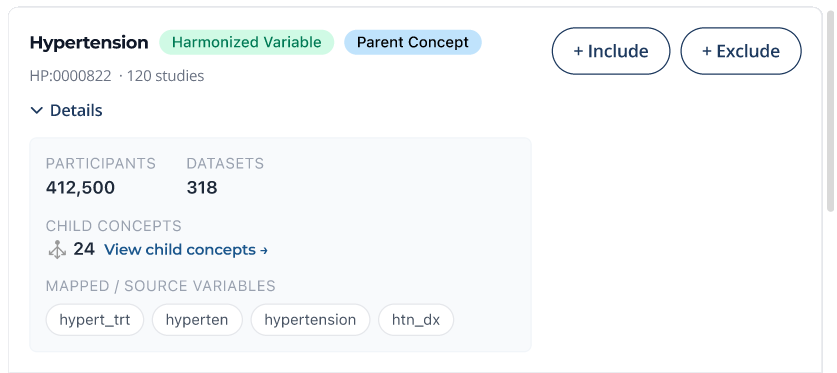

# Wireframe assessment: harmonized concept search

## Conclusion

The variable catalog and terms-response.yaml projection define searchable concept metadata and optional source-variable definitions. It deliberately adds no participant count, dataset
count or hierarchy fields. Those values cannot be inferred from IntegratedVariable or from the grouped VarLib annotations available for this work.

The numbers mentioned in the above snapshot (120, 412500, 318, 24) are placeholders, not verified data. The fixture has two synthetic integrated variables for one concept and two synthetic studies.

## Field-by-field decisions

| Wireframe                                     | Supported proposal and source                                                                                           | UI behavior                                                                                                                                                |
|-----------------------------------------------|-------------------------------------------------------------------------------------------------------------------------|------------------------------------------------------------------------------------------------------------------------------------------------------------|
| Hypertension title                            | concept.label from verified ontology metadata, else CURIE fallback                                                      | Show known label; never replace it with a file alias                                                                                                       |
| HP:0000822                                    | inherited concept_type linked to catalog concept                                                                        | Send the concept CURIE for existing concept-based filters                                                                                                  |
| Harmonized Variable badge                     | At least one actual integrated-variable definition for the concept                                                      | Treat as metadata coverage, not proof of participant data availability. Current alias index alone does not prove true IntegratedVariable identity          |
| 120 studies                                   | Distinct associated_study IDs reached through integrates                                                                | Label as mapped studies. Do not sum study counts per integrated variable. Existing specification coverage is spec coverage with different provenance       |
| Mapped/source variable chips                  | Optional SingleCategoricalVariable/SingleContinuousVariable records referenced through CompoundVariable.row_metadata.id | Use variable_name only for resolved source records. Preserve study and variable ID because names can repeat                                                |
| hypert_trt / hyperten / hypertension / htn_dx | These may be specification aliases; screenshot alone cannot establish actual source-variable identity                   | Existing aliases can remain labeled as specification aliases. Do not invent accessions or rename them as confirmed source variables                        |
| Parent Concept badge                          | Not supplied by the inspected variable contract                                                                         | Hide until an ontology/KG hierarchy source and definition are agreed                                                                                       |
| 24 child concepts / navigation                | Not supplied by the inspected variable contract                                                                         | Hide/disable. Requires hierarchy query, direct-vs-descendant semantics and pagination                                                                      |
| 412500 participants                           | Not derivable from variable definitions or number of mappings                                                           | Hide/show unavailable. Requires authorized distinct participant counts from the counting service                                                           |
| 318 datasets                                  | Neither the current supported endpoint nor this catalog establishes dataset coverage                                    | Omit. Future dataset support requires stable dataset IDs and explicit mappings/access semantics                                                            |
| Include / Exclude                             | Existing UI filter actions, separate from this metadata contract                                                        | For supported condition concepts use INCLUDE=PRESENT and EXCLUDE=explicit ABSENT, ONESELF. Do not imply all observation/procedure variables are filterable |

## Model changes backed by upstream definitions

The catalog extends IntegratedVariable, CompoundVariable and ResearchStudy. It optionally extends SingleCategoricalVariable and SingleContinuousVariable as well.
Their existing variable_name, source_id, file_id, file_name and source_variable_description fields describe actual source variables. No new invented clinical variable types are added.
The portal requires study and metadata provenance for source records. That is a reviewable portal constraint. Compound row_metadata.id resolves to these records, and its microschema_slot identifies the role (for example condition_status or age metadata).

These optional source lists make it possible to serve real chips when the producer supplies the links. Their addition does NOT mean the currently deployed grouped artifact has the
necessary identities. Missing links remain unavailable; they are never guessed. The validator fails if supplied row_metadata links do not resolve or point to a different study.
Upstream row_metadata may also describe metadata/helper variables, so the UI should retain microschemaSlots and not imply every chip is the primary harmonized value column.

Existing optional inherited fields variable_description, unit and cde_id are included in the proposed response mapping. They support future detail views without fabricating data. No synonym, parent/child, count, accessibility or ranking-score field was added speculatively.

## Search behavior and the current endpoint

preview_terms.py is an executable prototype: it searches concept labels, variable labels, descriptions and resolved source-variable names, groups by concept CURIE, and returns all
integrated-variable definitions for the matched concept. Exact CURIE input uses exact lookup. It demonstrates pagination and unknown-value behavior; it is not a deployed endpoint, Monarch search replacement, production relevance-ranking strategy or performance benchmark.

terms-response.yaml describes the harmonized-only metadata projection. Its total is the number of matching concept cards. The live terms endpoint currently mixes BdcConcept and
Term entries; its total has different semantics. Do not silently reinterpret that total. The recommended GraphQL evolution keeps the existing union and adds integratedVariables,
catalogStudyCount and catalogStudies to BdcConcept. See the future query/SDL examples. The mapper translates the LinkML snake_case response to those camelCase fields.

Keep concept and variable identity distinct: choosing a concept can feed the current summary filter; choosing a specific integrated variable requires a future variable-to-counting-query
mapping. Never send the variable ID as the concept CURIE. Do not automatically include child concepts when the parent is selected; descendant expansion is not implemented by this contract. The UI can preserve its existing nested AND/OR expression independently of catalog metadata.

## How to deliver missing fields later

| Gap                                        | Required work before populating UI                                                                                                                                                |
|--------------------------------------------|-----------------------------------------------------------------------------------------------------------------------------------------------------------------------------------|
| Real integrated/compound/source identities | Madan/Corey-approved producer output with explicit integrates, study and row_metadata links; actual data validation in middleware CI                                              |
| Parent/children                            | Choose ontology/KG source and release; define direct children versus all descendants; add a paginated service and hierarchy tests                                                 |
| Participant total                          | Count distinct canonical participants for an explicit concept/status/relationship, release, access and filter scope; suppression/unknown handling; no summing overlapping studies |
| Dataset total                              | Introduce authoritative dataset identifiers and variable-to-dataset links, deduplication and access rules; do not count file aliases as datasets                                  |
| Variable-specific filtering                | Agree how each integrated variable maps to indexed conditions/observations/thresholds; add supported capability metadata and tests when defined                                   |

See examples/terms-response.json for the generated illustrative output.
