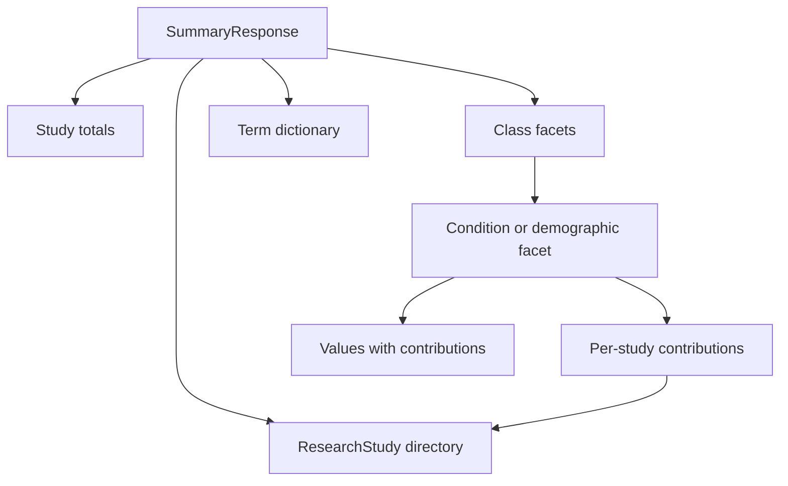

# Class-first summary contract

Each facet appears once under `summary`, with its counts in `studies`. This matches concept-first screens and gives a filter ID one response node to resolve. Summary IDs keep their existing meaning. This change updates the canonical `summary.yaml`.

- Root `studies` entries retain `research_study`, required `participant_count`, and optional `name`.
- `research_study` still references BDCHM ResearchStudy in `research_studies`.
- Each facet and nested value has per-study contributions. Neither facets nor the root carry a global participant count.
- Sum reported root study counts for the displayed meta-analysis study size. Sum contributions for an individual facet. Do not sum all facets or overlapping demographic categories. These sums are study-participant counts, not guaranteed distinct-person totals across studies.
- The unfiltered overview supplies study denominators. A filtered response supplies matching counts. Keep those responses separate and scoped to the same release and authorization context.
- `suppressed_study_count` reports the number of matching studies omitted below `min_count`, not their participant total. Missing cells are not zero.
- `terms` is keyed by CURIE. `focus`, relations, and the existing optional records block remain supported.
- `seed` is an optional legacy search-text echo, not a filtering instruction. Main now uses `focus`; which should be used for concept identity.
- Age remains `age_at_index`, as in the pinned BDCHM model and examples. Baseline age must not be silently substituted. Measurements retain the existing most-recent-value rule; a new selection policy is outside this shape change.
